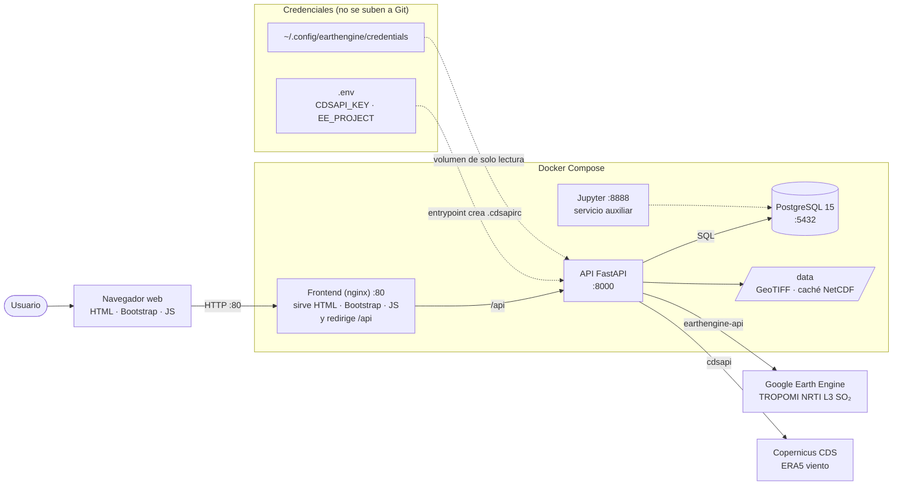

# VolcSO₂-Monitor

Sistema automatizado de monitoreo y cuantificación del flujo de dióxido de azufre (SO₂) volcánico a partir de datos satelitales TROPOMI/Sentinel-5P y viento del reanálisis ERA5.

---

## Descripción

Aplicación web que automatiza el flujo completo de estimación de emisiones de SO₂ volcánico:

1. **Descarga de imágenes TROPOMI** desde Google Earth Engine (colección `COPERNICUS/S5P/NRTI/L3_SO2`).
2. **Descarga de viento** desde ERA5 (Copernicus CDS API, 0,25°, resolución horaria, niveles de presión).
3. **Cálculo del flujo de SO₂** mediante el método de corte transversal de pluma.
4. **Visualización** en una interfaz web: mapa, series temporales, tablas y previsualización de las imágenes.

---

## Stack tecnológico

| Componente | Tecnología |
|---|---|
| Backend | FastAPI (Python 3.11) |
| Base de datos | PostgreSQL 15 |
| Frontend | HTML5, Bootstrap 5, Chart.js, Leaflet |
| Proxy inverso | nginx |
| Contenedores | Docker y Docker Compose |
| Datos satelitales | Google Earth Engine (`earthengine-api`) |
| Datos de viento | ERA5 vía Copernicus CDS (`cdsapi`) |
| Procesamiento | NumPy, SciPy, pandas, xarray, rasterio, Matplotlib |
| Análisis exploratorio (opcional) | Jupyter |

---

## Arquitectura



Servicios del `docker-compose.yml`:

| Servicio | Contenedor | Puerto | Función |
|---|---|---|---|
| `frontend` | `so2_frontend` | 80 | Sirve la interfaz y redirige `/api` a la API |
| `api` | `so2_api` | 8000 | Backend REST y cálculo de flujo |
| `postgres` | `so2_postgres` | 5432 | Almacén de datos |
| `jupyter` | `so2_jupyter` | 8888 | Análisis exploratorio (opcional; el sistema funciona sin él) |

---

## Requisitos previos

- **Docker** y **Docker Compose v2** (`docker compose`, con espacio).
- **Cuenta de Google** registrada en Earth Engine (uso no comercial) y un **proyecto de Google Cloud** asociado. Ver [Google Earth Engine](#google-earth-engine).
- **Cuenta en Copernicus CDS** con su token de API. Ver [ERA5](#era5-copernicus-cds).
- Python 3 con `venv` (solo para la autenticación de Earth Engine, una vez).

> **Importante:** use **siempre el mismo usuario** (no `root`) para autenticarse con Earth Engine y para ejecutar `docker compose`. El montaje de credenciales usa `$HOME`, que cambia según el usuario.

---

## Instalación

### 1. Clonar el repositorio

```bash
git clone https://github.com/tesis-unahur/VolcSO2-Monitor.git
cd VolcSO2-Monitor
```

### 2. Crear el archivo `.env`

```bash
cp .env.example .env
```

Edite `.env` y complete los valores (ver la [tabla de variables](#variables-de-entorno)):

```
CDSAPI_URL=https://cds.climate.copernicus.eu/api
CDSAPI_KEY=su_token_de_copernicus
EE_PROJECT=su_id_de_proyecto_de_google_cloud
```

El archivo `.env` contiene secretos y **está en `.gitignore`: nunca debe subirse al repositorio**.

### 3. Autenticar Google Earth Engine (una sola vez)

Ver el procedimiento completo en [Google Earth Engine](#google-earth-engine).

### 4. Levantar los servicios

```bash
docker compose up -d --build
docker compose ps
```

Deben aparecer los cuatro servicios en estado `Up`.

### 5. Verificar las conexiones

```bash
curl -s localhost:8000/api/gee/estado
```

Respuesta esperada:

```json
{"estado":"ok","mensaje":"Google Earth Engine está configurado correctamente", ...}
```

### 6. Acceder al sistema

| Dirección | Qué es |
|---|---|
| http://localhost | Interfaz web |
| http://localhost:8000/docs | Documentación interactiva de la API (Swagger) |
| http://localhost:8888 | Jupyter (el token se ve con `docker compose logs jupyter`) |

---

## Variables de entorno

Se definen en el archivo `.env` y el `docker-compose.yml` las carga con `env_file`.

| Variable | Obligatoria | Descripción |
|---|---|---|
| `CDSAPI_URL` | Sí | URL de la API de Copernicus CDS. Valor: `https://cds.climate.copernicus.eu/api` |
| `CDSAPI_KEY` | Sí | Token personal de Copernicus CDS (ERA5) |
| `EE_PROJECT` | Sí | ID del proyecto de Google Cloud registrado en Earth Engine |

Cómo se usan:

- **`CDSAPI_URL` y `CDSAPI_KEY`:** al arrancar, el script `entrypoint.sh` del contenedor de la API crea el archivo `/root/.cdsapirc` con estos valores. No hay que crear ese archivo a mano ni recrearlo después de cada `build`.
- **`EE_PROJECT`:** la API la lee para inicializar Earth Engine con el proyecto de cada usuario. Si no está definida, Earth Engine usa el proyecto guardado en el archivo de credenciales.

Variables de la base de datos (ya definidas en el `docker-compose.yml`): `DB_HOST`, `DB_PORT`, `DB_NAME`, `DB_USER`, `DB_PASSWORD`.

---

## Google Earth Engine

El sistema descarga las imágenes TROPOMI desde Google Earth Engine. La API necesita **credenciales de una cuenta de Google** y **un proyecto de Google Cloud**.

### Qué se necesita

1. Una cuenta de Google **personal** (las cuentas institucionales pueden estar bloqueadas por su administrador).
2. Registrar un proyecto para uso no comercial en https://code.earthengine.google.com/register
3. Que la cuenta tenga permisos sobre ese proyecto (rol *Propietario*, o *Earth Engine Resource Viewer* más *Service Usage Consumer*).

### Cómo funciona la conexión

```
earthengine authenticate  →  guarda  ~/.config/earthengine/credentials  (en su equipo)
docker compose            →  monta esa carpeta dentro del contenedor de la API
la API                    →  lee las credenciales y usa EE_PROJECT para conectarse
```

El `docker-compose.yml` monta la carpeta de solo lectura:

```yaml
volumes:
  - ${HOME}/.config/earthengine:/root/.config/earthengine:ro
```

### Autenticación paso a paso (Linux)

Con su usuario normal (no `root`):

```bash
python3 -m venv ~/venv-ee
source ~/venv-ee/bin/activate
pip install --upgrade earthengine-api

earthengine authenticate --auth_mode=localhost
earthengine set_project <ID_DEL_PROYECTO>
```

- `authenticate` abre el navegador: inicie sesión con su cuenta de Google y acepte los permisos. Si hay bloqueo, use una ventana de incógnito.
- `set_project` guarda el proyecto dentro del archivo de credenciales.

Compruebe que quedó bien:

```bash
ls -l ~/.config/earthengine/credentials
python3 -c "import ee; ee.Initialize(); print(ee.Image(1).getInfo()['type'])"
```

Debe imprimir `Image`. Luego reinicie la API para que tome la configuración:

```bash
docker compose up -d --force-recreate api
```

### Modos de autenticación

`earthengine authenticate` tiene varios modos y cada uno guarda en un lugar distinto:

| Opción | Dónde guarda | Cuándo usarlo |
|---|---|---|
| `--auth_mode=localhost` | `~/.config/earthengine/credentials` | Equipo con navegador (recomendado) |
| `--auth_mode=notebook` | `~/.config/earthengine/credentials` | Equipo sin navegador; se pega un código |
| `--auth_mode=gcloud` | Carpeta de `gcloud` (otra ubicación) | Si tiene `gcloud`, el comando lo elige solo; **el contenedor no lo ve** |

El sistema espera el archivo en `~/.config/earthengine/credentials`.

---

## ERA5 (Copernicus CDS)

1. Cree una cuenta en https://cds.climate.copernicus.eu/ y acepte los términos del conjunto de datos *ERA5 hourly data on pressure levels*.
2. Copie su token personal desde su perfil.
3. Colóquelo en `CDSAPI_KEY` del archivo `.env`.

No hace falta crear `.cdsapirc`: el contenedor lo genera al iniciarse.

---

## Uso

### Agregar un volcán

1. Pestaña **Volcanes**.
2. Elija un volcán predefinido o ingrese latitud, longitud y altura del cráter.
3. **Agregar**.

### Descargar imágenes TROPOMI

1. Pestaña **Extracción**.
2. Seleccione el volcán y el rango de fechas.
3. **Descargar desde GEE**. Las imágenes aparecen con estado "Pend".

### Procesar

1. Con el volcán seleccionado, **Procesar Pendientes**.
2. Para cada imagen el sistema detecta el azimut de la pluma, descarga el viento ERA5 (con caché por fecha) y calcula el flujo por franjas horarias.
3. Las imágenes pasan a estado "OK".

### Ver y exportar resultados

- Pestaña **Resultados**: seleccione volcán y fechas y **Buscar**. Vista **Día** (promedio diario) o **Detalle** (cada franja con altitud, dirección y velocidad del viento).
- **CSV** descarga los resultados.

---

## Método

Se implementa el método de corte transversal de pluma:

```
Flujo (kg/s) = SO₂máx (kg/m²) × distancia (m) × velocidad del viento (m/s)
```

- mol/m² → g/m²: × 64,1025; g/m² → kg/m²: × 0,001; kg/s → t/d: × 86,4.
- Franjas de transporte: 0,5; 1,0; 1,5; 2,0; 2,5 y 3,0 horas.
- El flujo final de cada imagen es el promedio de las franjas válidas.
- Azimut de la pluma: píxel de máxima columna en un anillo de 60 km ± 2,5 km alrededor del cráter.
- Nivel de viento: el nivel de presión ERA5 cuya dirección mejor coincide con el azimut de la pluma.
- Control de calidad: se descartan las imágenes con más del 40 % de píxeles sin dato.

Detalle completo en la memoria de la tesina (Capítulo IV, sección 4.5).

---

## Fuentes de datos

| Dato | Fuente | Detalle |
|---|---|---|
| SO₂ | Google Earth Engine, `COPERNICUS/S5P/NRTI/L3_SO2` | Banda de columna vertical de SO₂ (mol/m²), remuestreada a 1.000 m |
| Viento | ERA5 (Copernicus CDS) | Componentes u y v, 0,25°, resolución horaria, niveles de presión |

---

## Solución de problemas

| Síntoma | Causa y solución |
|---|---|
| `earthengine: no se encontró la orden` | La librería no está instalada: crear el entorno virtual y ejecutar `pip install earthengine-api` |
| "Esta aplicación está bloqueada" al autenticar | Cuenta institucional o política de la organización: use una cuenta personal y una ventana de incógnito |
| Error 401 `invalid_client` al autenticar | Pruebe `--auth_mode=localhost` en lugar de `notebook` |
| La interfaz muestra **GEE Error** | Ver el mensaje con `curl -s localhost:8000/api/gee/estado` |
| `Caller does not have required permission to use project …` | La cuenta no tiene permisos sobre `EE_PROJECT`: agregue los roles *Earth Engine Resource Viewer* y *Service Usage Consumer* en IAM |
| `Please authorize access to your Earth Engine account` dentro del contenedor | El contenedor no ve las credenciales: autentíquese y ejecute `docker compose` con el **mismo usuario**, y recree la API (`docker compose up -d --force-recreate api`) |
| Carpeta `~/.config/earthengine` vacía | Se autenticó con otro modo o con otro usuario (por ejemplo `root`); repita el procedimiento con `--auth_mode=localhost` |
| `/root/.cdsapirc: Is a directory` | Quedó un montaje antiguo de `.cdsapirc`: bórrelo del `docker-compose.yml` y elimine la carpeta `.cdsapirc` del proyecto |
| `container name ... is already in use` | Contenedores de una ejecución anterior: `docker rm -f so2_api so2_postgres so2_jupyter so2_frontend` y luego `docker compose up -d` |
| `Volume ... has incorrect format` | Ruta de Windows (`C:/...`) en el compose: use `${HOME}/...` |
| La interfaz no responde pero `docker ps` muestra la API detenida | `docker logs so2_api` muestra el error de arranque |

---

## Seguridad

- **No suba nunca** `.env`, `~/.config/earthengine/credentials` ni claves a Git. El archivo `.gitignore` ya excluye `.env`.
- Si una clave se expone, **revóquela y genere una nueva**: el token de CDS desde el perfil de Copernicus, y el acceso de Google desde https://myaccount.google.com/permissions.
- Cada persona debe usar **su propia cuenta y su propio proyecto**.

---

## Notas importantes

- La primera descarga de viento ERA5 para una fecha nueva tarda cerca de 30 segundos; las siguientes usan la caché local (`./data`).
- La detección automática de la pluma funciona mejor en días de emisión clara; con señal débil puede no detectarla o ser sensible al nivel de viento.
- Los valores absolutos de flujo dependen de la configuración (nivel de viento, perfil a priori del producto satelital, estadístico de agregación); ver el análisis de sensibilidad de la memoria (sección 5.4).

---

## Cómo citar

**Tesina (formato APA 7):**

Massey, F., & Rodriguez, A. (2026). *VolcSO₂-Monitor: sistema para la estimación del flujo de SO₂ volcánico a partir de datos TROPOMI/Sentinel-5P y ERA5* [Tesina de grado, Universidad Nacional de Hurlingham]. https://github.com/tesis-unahur/VolcSO2-Monitor

**Software:** véase el archivo `CITATION.cff`.

---

## Autoría

Tesina de grado, Licenciatura en Informática, Universidad Nacional de Hurlingham (UNAHUR).

**Autoras:** Florencia Massey, Ayelen Rodriguez

**Director:** Prof. Federico Carballo

